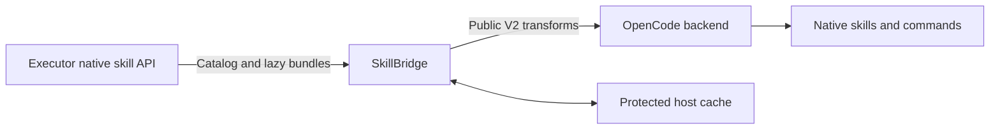

# SkillBridge

**TL;DR:** SkillBridge is an OpenCode V2 plugin that lists Executor skills and loads their instructions on demand. Clone this repository, build it, and configure the OpenCode backend to load the absolute local plugin directory. Distribution is through Git, not npm.

<!-- wtfm:revision -->
> Documents **v0.1.0** (`6cc4c67+dirty`) · Doc revision **2** · Updated 2026-10-11
> Latest change: Verified privacy fixes, cache recovery, and sanitized diagnostics
<!-- /wtfm:revision -->



Skill metadata loads first. A full bundle loads when a skill is used.

SkillBridge uses public `@opencode/plugin` APIs. It does not modify OpenCode or Executor, create another MCP server, or require a catalog checkout. It is not an OpenCode V1 plugin or a T3 Code plugin. With T3 Code, the **actual OpenCode backend** must load the configuration; changing only the client is not enough.

## Install from Git

Requirements: Git, Node.js **22 or later**, npm, an OpenCode V2 backend, and an Executor credential that can read the intended skills. Bun is required to run the tests, not to build the plugin.

1. Clone the source.

   ```sh
   git clone https://github.com/joshua-builds-stuff/skillbridge.git
   cd skillbridge
   ```

2. Install dependencies without lifecycle scripts.

   ```sh
   npm ci --ignore-scripts
   ```

3. Build the local plugin.

   ```sh
   npm run build
   ```

4. Store the token outside the repository. Use your secret manager to create a token-only file owned by the OpenCode service user. On POSIX, set mode `0600`.

   ```sh
   chmod 600 /absolute/path/outside-repo/executor-token
   ```

5. Add this entry to the configuration loaded by your OpenCode backend. Replace all example paths and the Executor origin.

   ```jsonc
   {
     "$schema": "https://opencode.ai/config.json",
     "plugins": [{
       "package": "/absolute/path/to/skillbridge",
       "options": {
         "url": "https://executor.example",
         "apiKeyFile": "/absolute/path/outside-repo/executor-token",
         "pollSeconds": 30
       }
     }]
   }
   ```

6. Restart or reload the backend using its normal procedure. Check for qualified skills such as `executor-org-<name>` and `executor-user-<name>`.

The plugin directory must contain the root `index.js` and built `dist/` files. Do not point configuration at `src/`.

Instead of `apiKeyFile`, use `"apiKeyEnv": "EXECUTOR_SKILLS_API_KEY"` and supply that variable in the **OpenCode server's environment**. A separately managed server does not inherit environment changes from an already-open client. Never put token values in plugin options or Git. `apiKeyFile` takes precedence when both options are set.

## Use skills

- Select a qualified skill through the host's native skill interface, where available. The exact picker controls depend on the client.
- Use a registered command such as `/executor-org-<name>`. There is no generic `/skills` command supplied by this plugin.
- Ask the agent to call `executor_skill_load` with `{"skill":"executor-org-<name>"}`.
- Read a bundled reference with `executor_skill_file` and `{"skill":"executor-org-<name>","path":"references/guide.md"}`. Use a path present in that skill's manifest.

The displayed path, such as `/skillbridge/executor-org-name/remote.md`, is **virtual**, not a local directory. Bundles remain remote source data with verified copies in host storage. They are not installed as a writable directory. Text files return UTF-8; binary files return base64, size, and digest. Scripts are reference data and are not automatically executed.

## Configuration and limits

| Option | Default | Purpose |
| --- | --- | --- |
| `url` | Required | Executor origin only; no path, query, fragment, or embedded credentials. |
| `apiKeyEnv` | `EXECUTOR_SKILLS_API_KEY` | Environment variable that contains the token. |
| `apiKeyFile` | Unset | Absolute token-file path; overrides `apiKeyEnv`. |
| `pollSeconds` | `30` | Catalog refresh interval, from 10 to 3600 seconds. |
| `allowInsecureHttp` | `false` | Allow HTTP only for a trusted test environment. |

HTTPS is required by default. Redirects are refused. Use a read-only Executor credential scoped to the intended workspace or subject; personal visibility follows that credential.

Polling picks up edits and deletions. Executor's get API returns a whole bundle, so the first file read also fetches the whole bundle. Each bundle is limited to 2048 files and 64 MiB; `SKILL.md` is limited to 512 KiB. HTTP responses are bounded to 96 MiB. Every file's byte count and SHA-256 digest must match the current manifest.

Verified bundles and metadata are stored in OpenCode's plugin storage, partitioned by endpoint and credential fingerprint. Previously used revisions can load offline. Uncached revisions fail rather than fabricate content. Protect this storage: it contains skill content. Activation removes superseded endpoint/credential cache partitions from this plugin's location-scoped storage. Unloading cancels polling; the host disposes registrations.

Startup and refresh remove stale bundle revisions, including cleanup interrupted
by a previous process. Remote-error diagnostics omit response fragments and private
filenames. Storage failures can delay deletion; backups remain outside this cleanup.

Limits apply per bundle and response, not to the total cache. There is no aggregate memory/disk quota or global download-concurrency cap. Use a scoped credential and avoid selecting many large skills at once.

**Permissions gate disclosure to the model, not retrieval or caching.** A denied call can still download and verify a bundle before the native permission check. See [security guidance](SECURITY.md).

## Why the plugin uses Executor's API

OpenCode's public V2 plugin API can configure and inspect MCP server status,
but it does not expose the live MCP client or the `skills/list`, `skills/get`,
and `resources/read` extension methods. Importing OpenCode core internals would
make this package version-coupled and violate the standalone-plugin boundary.
The plugin therefore reads the same native Executor skill store through its
read-only authenticated HTTP API, then registers each entry through
`ctx.skill.transform`. No second MCP server is created.

## Host integration limits

Skill names use `executor-org-` and `executor-user-` prefixes. The plugin does not
add a source chooser, remote/offline badges, or custom autocomplete. The host
displays a virtual path; loaded instructions direct agents to the file tool.
Bundles are not materialized as writable or executable directories. Native skill
selections and slash commands are supported. Standard host permission prompts apply.
Permission gates disclosure to the model. The native skill tool's public
`execute.before` hook runs before its permission check, so a denied direct
native skill call may already have downloaded and verified the bundle into the
protected host cache; the plugin cannot reverse that ordering through public
APIs.

Do not enable multiple import mechanisms for the same Executor catalog unless
duplicate entries are intentional. Validate the plugin on your intended OpenCode
V2 backend before switching a production client.

## Development and verification

The disposable-copy verification passes install, typecheck, all 29 tests, build,
entrypoint loading, and package dry-run checks. Tests use a simulated host, not a
stock OpenCode integration test. See the [verification record](docs/verification.md).

```sh
npm run typecheck
npm test
npm run build
npm run test:entrypoint
```

`npm test` runs `bun test test`. The declared SDK peer range is `@opencode/plugin >=2.0.17 <3`; the development dependency is pinned to `2.0.17`. That declaration is not evidence that every version or platform works.

The local checks used Node.js 22 and Bun 1.4.2. The GitHub workflow uses the same
runtime versions and does not require Executor credentials.

A historical T3 Code smoke test, **before the SkillBridge rename**, activated the plugin, listed 401 skills, and hydrated one selected skill. It is not a guarantee for the renamed plugin, a new installation, or the current catalog. See the [audit record](docs/security-audit.md) for verification scope.

## Documentation

- [User procedures and troubleshooting](docs/usability.md)
- [Implementation and maintenance](docs/implementation.md)
- [Security policy](SECURITY.md)
- [Security audit and verification record](docs/security-audit.md)
- [Verification scope and results](docs/verification.md)
- [Change history](CHANGELOG.md)
- [Report an issue](https://github.com/joshua-builds-stuff/skillbridge/issues)

## License

[MIT](LICENSE).
