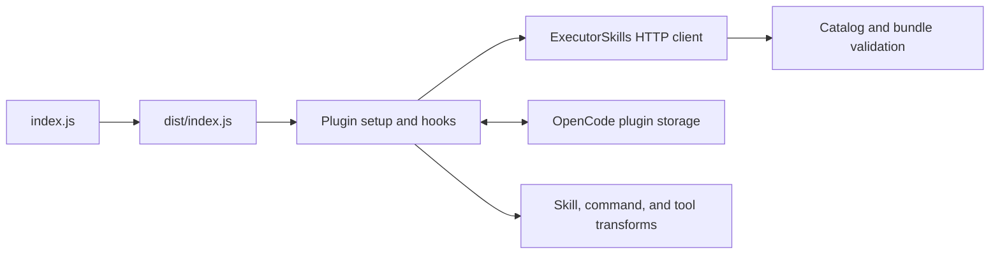

# Implementation

**TL;DR:** SkillBridge registers Executor skills through the public OpenCode V2 plugin API. `src/index.ts` manages registration, polling, credentials, and cache state; `src/catalog.ts` validates API data and bundle integrity.

<!-- wtfm:revision -->
> Documents **v0.1.0** (`4fd8f3e+dirty`) · Doc revision **1** · Updated 2026-10-11
> Latest change: Git distribution and clean-copy verification documented
<!-- /wtfm:revision -->

## Architecture



The root entrypoint loads the compiled plugin. No standalone UI or local bundle directory is created.

| Component | Responsibility |
| --- | --- |
| `src/index.ts` | Defines plugin ID `skillbridge`, options, lifecycle, transforms, hooks, and tools. |
| `src/catalog.ts` | Defines schemas, qualified IDs, revisions, transport, verification, and instruction formatting. |
| `index.js` | Re-exports the default plugin from `dist/index.js`. |
| `test/catalog.test.ts` | Exercises validation, revision comparison, binary data, and read-only transport fixtures. |
| `test/plugin.test.ts` | Exercises registration, hydration, permission denial, concurrent loads, offline cache, cache pruning, and URL rejection. |

## Repository map

- `src/`: TypeScript implementation.
- `test/`: Bun tests with a simulated public plugin context and mocked HTTP responses.
- `dist/`: Generated JavaScript and type declarations from the build.
- `docs/`: User, implementation, and audit documentation.
- `package.json`: Commands, dependency versions, Node requirement, and SDK peer declaration.
- `package-lock.json`: Locked npm dependency graph.
- `tsconfig.json`: Strict TypeScript, NodeNext modules, and declaration output.
- `SECURITY.md`, `CHANGELOG.md`, `LICENSE`: Policy, history, and license.

## Main flow

1. `setup` validates options and captures the credential once.
2. `pruneOtherCaches` removes superseded endpoint/credential partitions in location-scoped plugin storage.
3. A valid cached catalog seeds the in-memory state.
4. Transforms register qualified skills, matching commands, and two tools.
5. `refresh` reads `GET /api/skills`, persists changed metadata, and reloads registrations.
6. A prompt hook, native tool hook, or file/load tool calls `load` on first use.
7. `load` checks memory and storage before calling `GET /api/skills/{owner}/{name}`.
8. `verify` checks the bundle against the current catalog revision and verifies every file's bytes.
9. The host's native `skill` executor applies its permission check before tool content is returned.

`load` deduplicates concurrent downloads for the same skill revision. It checks the current catalog again after download. A changed revision is reloaded; a removed skill fails. Verified memory state remains usable if bundle persistence fails.

`refresh` invalidates changed or removed bundles. Revision-qualified storage keys
keep stale cleanup separate from newly hydrated bundles. A retryable cleanup queue
retains work after storage or registry failures. Polling schedules a timeout after
each refresh. Cleanup aborts network work and cancels the next poll.

Stored keys in the active credential partition are also reconciled with the current
catalog. Startup reconciliation recovers stale work lost when the previous process
stopped before deletion. Current revision keys remain usable offline.

## Public interfaces

| Interface | Input or identity | Result |
| --- | --- | --- |
| Plugin | `skillbridge` | Public OpenCode V2 plugin. |
| Native skill and command | `executor-org-<name>` or `executor-user-<name>` | Registered instructions or a prompt with the selected skill. |
| `executor_skill_load` | `{ "skill": "executor-org-<name>" }` | Native permission-checked skill content. |
| `executor_skill_file` | `{ "skill": "executor-org-<name>", "path": "references/guide.md" }` | JSON content with exact manifest path, digest, size, content, and encoding. |
| Display path | `/skillbridge/executor-org-name/remote.md` | Virtual host path, not a filesystem target. |

Loaded instructions strip leading frontmatter. They identify the remote source and direct the agent to `executor_skill_file` for bundled references. Scripts are not installed or executed.

## Design decisions

- **Direct API instead of host MCP internals:** The public plugin context does not expose the live MCP client's skill extension methods. See the [original rationale](../README.md#why-the-plugin-uses-executors-api).
- **Qualified names:** Organization and personal entries use separate `executor-org-` and `executor-user-` IDs. This does not add a fork-specific source chooser.
- **Lazy whole bundles:** The native get API returns a whole bundle. First use fetches it; startup fetches only the catalog.
- **Manifest-bound cache:** Revisions include owner, name, description, frontmatter, and sorted file metadata. File ordering and timestamps do not define the revision.
- **Native permission enforcement:** Custom tools delegate to the host's native skill executor. Retrieval can happen before permission denial; this is not a network-access permission gate.
- **Git distribution:** Install a built local checkout. npm is the dependency and build tool, not the distribution channel.

## Configuration

See the [README option table](../README.md#configuration-and-limits) for defaults. `url` must be an origin. HTTPS is required unless `allowInsecureHttp` explicitly permits HTTP. Redirects are refused.

The default credential variable is `EXECUTOR_SKILLS_API_KEY`. `apiKeyFile` takes precedence. The file path must be absolute and identify a regular file. POSIX checks reject group/world access and a different owner. Windows does not use the POSIX mode check; configure access controls separately. Credentials are captured at setup, so restart or reload after rotation.

The cache prefix hashes the endpoint and credential together. The credential value is not stored in the cache. Skill content is stored and still needs protection.

## Build and test

Use Node.js 22 or later and npm. Install Bun to run tests. From a local checkout:

```sh
npm ci --ignore-scripts
npm run typecheck
npm test
npm run build
npm run test:entrypoint
```

Disposable-copy install, typecheck, all 29 fixture tests, build, entrypoint, and
package dry-run checks pass. Fixture tests are not a stock-host integration test.
Historical live-host evidence predates the rename; see [verification scope](verification.md).

The declared SDK peer range is `>=2.0.17 <3`; development uses `2.0.17`. Do not interpret that range as a tested compatibility matrix.

## Extend the plugin

1. Change API schemas or integrity rules in `src/catalog.ts`.
2. Change lifecycle or host registration in `src/index.ts`.
3. Add fixture coverage for the changed behavior in `test/`.
4. Run the checks above.
5. Verify activation on the intended OpenCode V2 backend before changing compatibility claims.

## Known limits

- Catalogs are limited to 10,000 entries; bundles to 2048 files and 64 MiB.
- `SKILL.md` is limited to 512 KiB; serialized frontmatter to 256 KiB.
- Each HTTP response is limited to 96 MiB, with a 30-second request timeout.
- Cached manifests and bundles are revalidated, but integrity is not proof that instructions are safe.
- A denied native or custom tool call can already have fetched and cached a bundle.
- Offline use requires a cached catalog and the matching verified bundle revision.
- Aggregate memory, disk cache, and concurrent downloads have no global quota. Per-bundle limits are not aggregate resource limits.
- No remote/offline badges, fork-specific autocomplete, bundle installation, or automatic script execution are added.
- T3 Code must connect to a backend that actually loads the plugin. This is not a T3 frontend extension.

See [security policy](../SECURITY.md) and [change history](../CHANGELOG.md).
